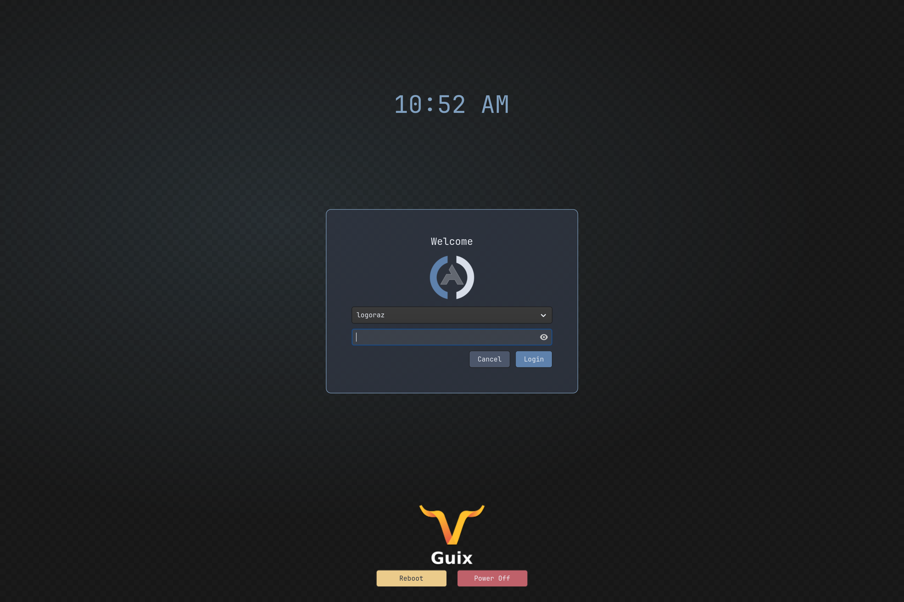
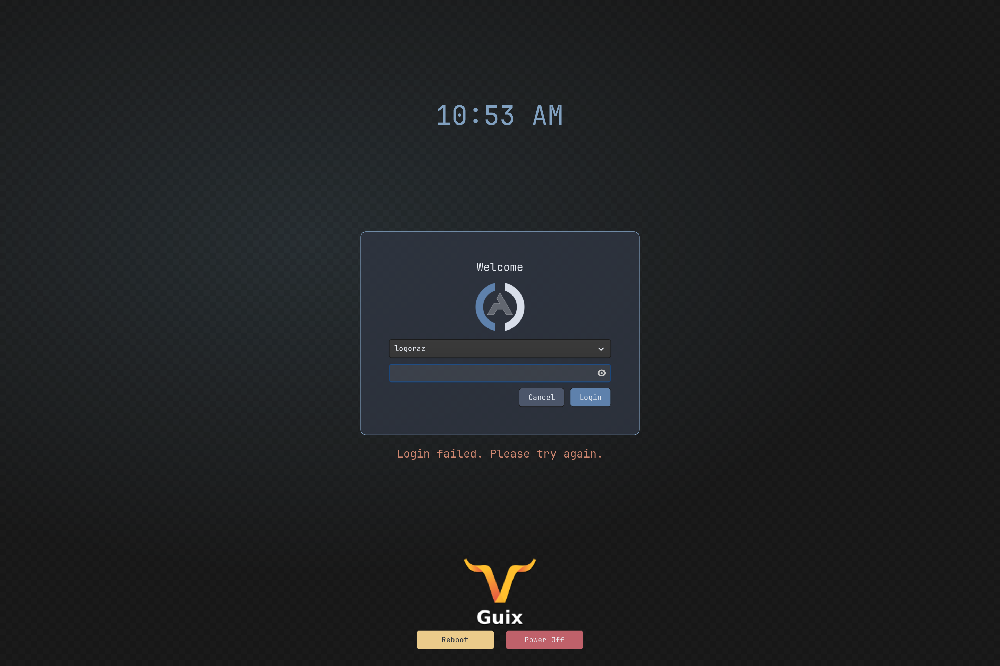

# cloak


A highly configurable GTK4 greetd greeter, written in Common Lisp.

 - Looks good out of the box, with a Nord theme as the default
 - One s-expression file configures everything
 - Themes colors, transparency, wallpaper, font, cursor, clock and avatar
 - Multi-monitor: the form on your primary, wallpaper on the rest
 - Custom CSS for anything the config does not cover
 - Built for GuixOS; runs on any system with greetd and sway

Early development; expect changes.


<p align="center">
  
</p>

<p align="center">
  
</p>

## Requirements

SBCL, GTK4, libadwaita, gtk4-layer-shell and a Wayland compositor that
supports layer-shell (sway). Without layer-shell it falls back to
fullscreen windows.


## Install

### Guix

Add the repository as a channel:

```scheme
(channel
 (name 'cloak)
 (url "https://codeberg.org/logoraz/cloak")
 (branch "main"))
```

Then use the service in your operating system:

```scheme
(use-modules (cloak services))

(service cloak-service-type)
(service greetd-service-type
         (greetd-configuration
          (terminals
           (list
            (greetd-terminal-configuration
             (terminal-vt "1")
             (default-session-command
              (greetd-cloak-sway-session
               (sway-configuration %greetd-conf)
               (cloak-configuration
                (cloak-configuration
                 (greeting "Welcome")
                 (theme (cloak-theme (alpha 0.9))))))))))))
```

Fields left unset keep cloak's defaults.

For a complete setup, including the sway configuration
(`%greetd-conf`), see my [guixos](https://codeberg.org/logoraz/guixos)
repository.

### Other systems

Run `cloak` from a greeter-only sway config that greetd starts, with
`libgtk4-layer-shell.so` in `LD_PRELOAD`:

```
exec "env LD_PRELOAD=/path/to/libgtk4-layer-shell.so cloak; swaymsg exit"
```


## Configuration

The file is read from `/etc/greetd/cloak.sexp`; change it with
`--config`. It is plain data, never evaluated, and every setting is
optional. Bad values warn in the log and use the default.

```lisp
(:user     (:name "locutus" :avatar "/path/avatar.png")
 :theme    (:background "#2e3440" :foreground "#e5e9f0"
            :border "#81a1c1" :alpha 0.9
            :wallpaper (:path "/path/wallpaper.png" :fit :cover))
 :layout   (:primary "eDP-1")
 :clock    (:format "%I:%M %p" :color "#81a1c1" :size "48px")
 :greeting "Welcome")
```

Paths must be absolute. See `docs/config.sexp` for every setting.

| Flag       | Purpose                       | Default                  |
|------------|-------------------------------|--------------------------|
| `--config` | config file                   | `/etc/greetd/cloak.sexp` |
| `--style`  | extra CSS file                | none                     |
| `--log`    | log file, rotated, 5 kept     | `/var/log/cloak/log`     |

The last user and session are kept in `/var/lib/cloak/state.sexp`.


## Development

```sh
guix shell -m manifest.scm
export LD_LIBRARY_PATH="$GUIX_ENVIRONMENT/lib:$LD_LIBRARY_PATH"
sbcl --eval '(asdf:test-system "cloak")'
```

Build the package from a checkout with
`guix build -L guix -f guix.scm`.


## License

```lisp
(defmacro license-terms (system . plist)
  "See LICENSE for the actual legally-binding, non-parenthesized version."
  (declare (optimize (safety 0))) ; use at your own risk
  `(list :system ',system ,@plist))

(license-terms cloak
  :type        '(:MIT . "https://spdx.org/licenses/MIT.html")
  :permissions '(:use :copy :modify :merge :publish :distribute
                 :sublicense :sell)
  :conditions  '(:include-copyright-notice
                 :include-license-notice)
  :warranty    nil)
```

↳ [LICENSE](LICENSE)

<p align="center">
  
</p>
